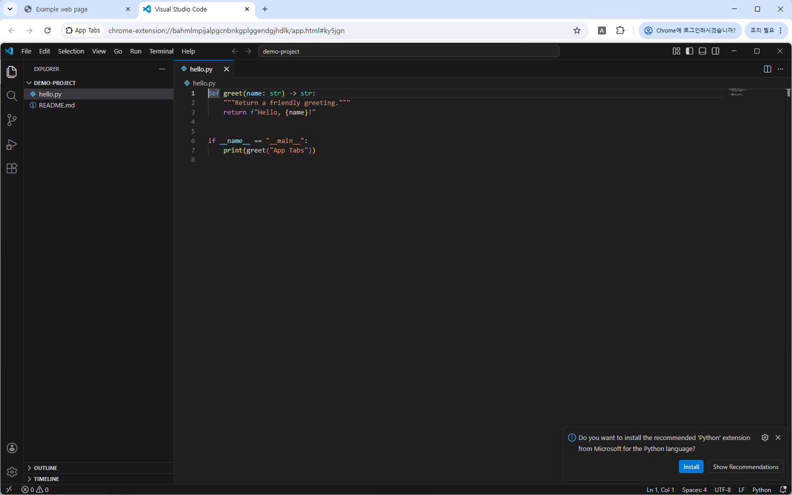
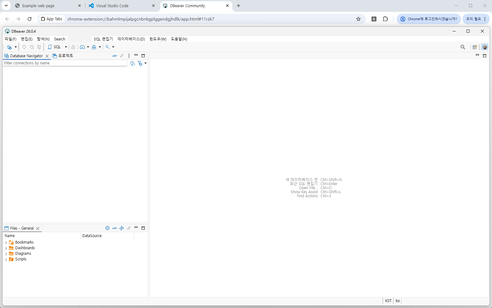
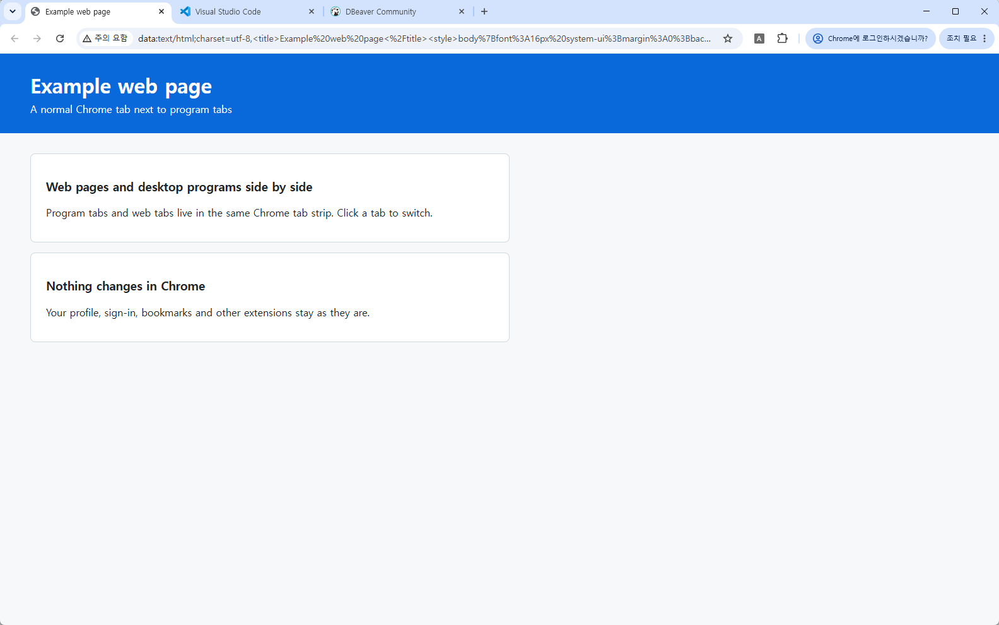
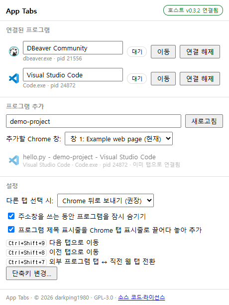

# Chrome App Tabs

[English](README.md) | **한국어**

이미 실행 중인 Windows 프로그램(VS Code, DBeaver, 파일 탐색기 등)을 **지금 쓰는 Google Chrome의 탭처럼** 사용합니다.
프로그램 탭을 누르면 Chrome 화면 영역에 그 프로그램이 나타나고, 웹 탭을 누르면 다시 웹페이지로 돌아갑니다.

[](https://github.com/darkping1980/chrome-app-tabs/releases/latest)
[](LICENSE)

> **내려받기:** [최신 Release](https://github.com/darkping1980/chrome-app-tabs/releases/latest) → `ChromeAppTabs-vX.Y.Z.zip`
> 무료 오픈소스(GPL-3.0)입니다. Windows 전용, Google Chrome 전용입니다.



---

## 목차

- [소개](#소개)
- [사용 화면](#사용-화면)
- [시스템 요구사항](#시스템-요구사항)
- [설치 방법 (일반 사용자)](#설치-방법-일반-사용자)
- [사용 방법](#사용-방법)
- [업데이트 방법](#업데이트-방법)
- [제거 방법](#제거-방법)
- [문제 해결 및 FAQ](#문제-해결-및-faq)
- [알려진 한계](#알려진-한계)
- [개발자용 문서](#개발자용-문서)
- [라이선스](#라이선스)

## 소개

Chrome App Tabs는 Windows에서 실행 중인 데스크톱 프로그램을 기존 Chrome 브라우저의 탭처럼 쓸 수 있게 해 주는 무료 오픈소스 생산성 도구입니다.
웹페이지와 데스크톱 프로그램을 탭을 바꾸듯이 오갈 수 있습니다.

- **기존 Chrome을 그대로 사용합니다.** 프로필, 로그인, 북마크, 쿠키, 다른 확장 프로그램이 그대로 유지됩니다. 별도 브라우저가 아닙니다.
- **일반 Windows 프로그램이라면 무엇이든** Chrome 탭으로 연결할 수 있습니다(VS Code, DBeaver, 파일 탐색기, 메모장 등).
- **드래그 앤 드롭:** 프로그램의 제목 표시줄을 Chrome 창 위쪽(탭 표시줄 또는 주소창)으로 끌어다 놓으면 추가됩니다.
- **관리 팝업:** 툴바 팝업에서 프로그램 탭을 추가, 이름 변경, 이동, 다시 열기, 연결 해제할 수 있습니다.
- **빠른 전환:** 웹페이지와 데스크톱 프로그램 사이를 탭 클릭이나 전역 단축키로 오갑니다.
- **프로그램 내부를 수정하지 않습니다.** 프로그램의 파일, 설정, 메모리를 건드리지 않습니다.
- **원상 복구:** 탭 연결을 해제하거나 Chrome이 닫히거나 비정상 종료되면 프로그램 창이 원래 위치와 크기로 돌아갑니다.
- **관리자 권한 없이** 설치합니다.
- **무료**이며 GNU GPL v3 라이선스입니다.

### 동작 원리 (하는 일과 하지 않는 일)

프로그램 창을 Chrome 안에 실제로 **삽입하는 방식이 아닙니다.** **Windows 창 오버레이** 방식입니다.
작은 네이티브 도우미(`AppTabsHost.exe`)가 프로그램 탭이 선택되어 있는 동안 실제 프로그램 창을 Chrome의 웹페이지 영역 위에 정확히 겹쳐 놓습니다.
다른 탭을 고르면 프로그램 창을 Chrome 뒤로 보냅니다. Chrome 창을 이동, 크기 변경, 최대화, 최소화하면 그대로 따라갑니다.

창의 **위치, 크기, 표시 여부, 앞뒤 순서, 포커스**만 바꿉니다.
DLL 주입, 다른 프로그램의 메모리 접근, 창 강제 삽입(`SetParent`), 프로그램 파일이나 설정 수정, 프로그램 종료는 하지 않습니다.
프로그램 탭을 닫아도 프로그램은 종료되지 않습니다.

Chrome 확장 프로그램과 네이티브 도우미는 Chrome 공식 [Native Messaging](https://developer.chrome.com/docs/extensions/develop/concepts/native-messaging) API로 통신합니다.

## 사용 화면

| | |
|---|---|
| **VS Code를 Chrome 탭으로 추가한 화면**  | **DBeaver를 Chrome 탭으로 연결한 화면**  |
| **일반 웹페이지 탭으로 전환한 화면** (프로그램 탭은 탭 표시줄에 그대로 남음)  | **관리 팝업** (연결된 프로그램, 프로그램 추가, 설정)  |

드래그 앤 드롭 화면은 [사용 방법](#사용-방법)에서 글로 설명합니다.

## 시스템 요구사항

| 항목 | 내용 |
|---|---|
| 운영체제 | **Windows 11 64비트**에서 검증했습니다. Windows 10 64비트는 동작할 것으로 예상하지만 **검증하지 않았습니다**. macOS, Linux는 지원하지 않습니다. |
| 브라우저 | **Google Chrome**(Chrome 158에서 검증). Edge, Brave 등 다른 Chromium 브라우저는 **지원하지 않습니다**(네이티브 도우미를 Google Chrome에만 등록합니다). |
| 네이티브 호스트 | `AppTabsHost.exe`가 **반드시 필요합니다.** Release ZIP에 들어 있고 `Install-or-Update.cmd`가 설치합니다. |
| .NET | Windows 10/11에 기본 포함된 .NET Framework 4.x를 사용합니다. 따로 설치할 것이 없습니다. |
| 관리자 권한 | **필요 없습니다.** 현재 Windows 사용자에게만 설치됩니다. |
| Chrome 개발자 모드 | **필요합니다.** Chrome 웹 스토어에 등록되지 않았으므로 "압축해제된 확장 프로그램"으로 로드합니다. |
| 별도 개발 도구 | 일반 사용자는 **필요 없습니다.** 개발자도 Windows 기본 구성으로 빌드합니다([개발자용 문서](#개발자용-문서) 참조). |

## 설치 방법 (일반 사용자)

소스 코드를 Clone하거나 직접 빌드할 필요가 없습니다. GitHub Release의 ZIP 파일 하나로 설치합니다.

### 1단계 – 내려받기

1. [**GitHub Releases 페이지**](https://github.com/darkping1980/chrome-app-tabs/releases/latest)에 접속합니다.
2. **Assets**에서 최신 안정 버전 **`ChromeAppTabs-vX.Y.Z.zip`**을 내려받습니다.
3. (선택) 파일이 손상되지 않았는지 확인합니다. 같은 페이지의 `.sha256` 파일 값과 비교합니다.
   ```powershell
   Get-FileHash .\ChromeAppTabs-v0.3.4.zip -Algorithm SHA256
   ```

### 2단계 – 압축 해제와 설치 스크립트 실행

4. ZIP 파일을 마우스 오른쪽 버튼으로 눌러 **압축 풀기**를 합니다. 위치는 어디든 괜찮습니다(예: 다운로드 폴더).
5. 압축을 푼 폴더에서 **`Install-or-Update.cmd`**를 더블클릭합니다.
   - 콘솔 창이 열리고 진행 내용이 표시됩니다. 관리자 권한 확인 창은 뜨지 않습니다.
   - 패키지 파일 손상 여부를 확인하고, `%LOCALAPPDATA%\ChromeAppTabs\app`에 파일을 복사하고, 현재 사용자 레지스트리 키 1개를 등록합니다.
   - 무엇이 바뀌는지 미리 보려면 그 폴더에서 `powershell -ExecutionPolicy Bypass -File .\setup.ps1 -DryRun`을 실행합니다.
6. **설치 완료** 메시지를 확인한 뒤 아무 키나 눌러 창을 닫습니다.

> **Windows 보안 경고가 나타날 수 있습니다.** 설치 파일에 코드 서명이 없어서 Windows SmartScreen이나 백신이 경고할 수 있습니다.
> 이 저장소의 Releases 페이지에서만 내려받고, SHA-256 값을 확인하세요. 스크립트는 일반 텍스트이므로 직접 열어 볼 수도 있습니다.
> 확신이 서지 않으면 실행하지 마세요. **설치를 위해 Windows 보안 기능을 끄지 마세요.**

### 3단계 – Chrome에 확장 프로그램 로드 (처음 한 번만)

7. Chrome 주소창에 **`chrome://extensions`**를 입력하고 Enter를 누릅니다.
8. 오른쪽 위의 **개발자 모드**를 켭니다.
9. **압축해제된 확장 프로그램을 로드합니다** 버튼을 누릅니다.
10. **폴더 선택 창**이 열리면, 그 창의 **주소 표시줄**에 다음 경로를 붙여 넣고 Enter를 누릅니다.
    ```
    %LOCALAPPDATA%\ChromeAppTabs\app\extension
    ```
11. **`extension`** 폴더가 열린(또는 선택된) 상태에서 **폴더 선택**을 누릅니다.
12. **App Tabs** 카드가 나타나고 활성화되어 있는지 확인합니다. ID는 `bahmlmpijalpgcnbnkgplggendgjhdlk`입니다.
13. Chrome 도구 모음의 **퍼즐 아이콘**(확장 프로그램)을 누르고 App Tabs를 **고정**합니다.
14. **App Tabs** 아이콘을 눌러 팝업 오른쪽 위에 **호스트 v0.3.4 연결됨**이 표시되는지 확인합니다.
15. 팝업의 **설정**에서 **프로그램 제목 표시줄을 Chrome 탭 표시줄로 끌어다 놓아 추가**가 켜져 있는지 확인합니다(기본값: 켜짐).

> **자주 하는 실수**
> - `%LOCALAPPDATA%\ChromeAppTabs\app\extension` 경로는 **Chrome 주소창에 입력하는 것이 아닙니다.** **압축해제된 확장 프로그램을 로드합니다**를 눌렀을 때 나타나는 **폴더 선택 창**에 입력합니다.
> - `manifest.json`을 직접 열거나 실행하는 것이 아닙니다. **`extension` 폴더 전체**를 선택합니다.
> - 현재 **Chrome 웹 스토어에 등록되지 않았으므로** 개발자 모드가 필요합니다. 개발자 모드는 켠 채로 두면 됩니다.

## 사용 방법

### 드래그 앤 드롭으로 프로그램 추가

1. VS Code 같은 프로그램을 실행합니다.
2. 프로그램 창의 **제목 표시줄**을 잡고 Chrome 창 **위쪽**(탭 표시줄, 주소창 줄, 북마크바)으로 끌고 갑니다.
   Chrome이 최대화되어 있어도 됩니다.
3. **파란색 드롭 영역**("여기에 놓으면 Chrome 탭으로 추가")이 표시되면 마우스를 놓습니다.
4. 그 Chrome 창에 프로그램 이름과 아이콘이 붙은 탭이 생기고, 웹페이지 영역에 프로그램이 표시됩니다.

- 그 밖의 곳(예: 웹페이지 위)에서 놓으면 평소처럼 창만 이동합니다.
- 화면 맨 위 가장자리에 닿으면 그곳은 Windows Snap(최대화/스냅 레이아웃)이 처리합니다. 마우스를 조금 아래로 내렸다가
  다시 Chrome 위로 올려 놓으면 됩니다.
- 끄는 도중 **Esc**를 누르면 취소되고 창이 제자리로 돌아갑니다.
- 이미 탭으로 연결된 프로그램은 다시 추가되지 않습니다.

### 관리 팝업에서 직접 추가

1. 도구 모음의 **App Tabs** 아이콘을 누릅니다.
2. **프로그램 추가** 목록에서 원하는 창을 누릅니다. 검색 칸에 창 제목이나 프로그램 이름 일부를 입력하면 목록이 좁혀집니다.
3. Chrome 창이 여러 개면 **추가할 Chrome 창**에서 대상 창을 고릅니다.

### 프로그램 탭과 웹페이지 탭 전환

- **웹 탭**을 누르면 웹페이지가 보이고 프로그램은 Chrome 뒤로 물러납니다.
- **프로그램 탭**을 누르면 프로그램이 다시 보입니다. 키보드와 마우스 입력은 프로그램에 그대로 전달됩니다.
- 프로그램 탭에서 **주소창**을 누르면 자동완성 목록이 보이도록 프로그램이 잠시 뒤로 물러납니다.
  **Esc**를 누르거나 페이지를 누르면 다시 나타납니다. 주소를 입력하고 Enter를 누르면 그 탭은 웹 탭이 되고 프로그램은 원래 위치로 돌아갑니다.

### 탭 이름 변경, 이동, 다시 열기, 연결 해제

팝업의 **연결된 프로그램**에서 다음을 할 수 있습니다.

| 버튼 / 입력란 | 동작 |
|---|---|
| 이름 입력란 | 탭 이름을 고치고 **Enter**를 누릅니다. |
| **이동** | 해당 탭으로 이동합니다. |
| **탭 다시 열기** | 탭은 닫혔지만 연결 정보가 남아 있을 때(예: 업데이트 후) 탭을 다시 엽니다. |
| **연결 해제** | 탭을 닫고 프로그램을 원래 위치로 되돌립니다. 프로그램은 종료되지 않습니다. |

### 단축키

프로그램에 키보드 포커스가 있을 때도 동작합니다.

| 단축키 | 동작 |
|---|---|
| `Ctrl+Shift+7` | 프로그램 탭 ↔ 직전 웹 탭 |
| `Ctrl+Shift+8` | 이전 탭 |
| `Ctrl+Shift+9` | 다음 탭 |

팝업의 **단축키 변경…**을 누르면 `chrome://extensions/shortcuts`가 열립니다. 프로그램에 포커스가 있을 때도 동작하게 하려면 범위를 **전역**으로 두세요.

### 설정 (팝업 아래쪽)

| 설정 | 선택지 |
|---|---|
| **다른 탭 선택 시** | **Chrome 뒤로 보내기**(권장) 또는 **최소화** |
| **주소창을 쓰는 동안 프로그램을 잠시 숨기기** | 켬 / 끔 |
| **프로그램 제목 표시줄을 Chrome 탭 표시줄로 끌어다 놓아 추가** | 켬 / 끔. 끄면 창 이동이 완전히 평소대로 동작합니다. |

## 업데이트 방법

1. [GitHub Releases](https://github.com/darkping1980/chrome-app-tabs/releases/latest)에서 최신 `ChromeAppTabs-vX.Y.Z.zip`을 내려받습니다.
2. 압축을 풉니다.
3. **`Install-or-Update.cmd`**를 실행합니다.
   - App Tabs가 실행 중이면 계속할지 묻습니다(`Y`). **App Tabs 도우미만** 잠시 종료합니다.
     Chrome, VS Code 등 다른 프로그램은 **종료하지 않습니다.** 연결돼 있던 프로그램 창은 원래 위치로 돌아가고 저장하지 않은 작업 내용도 그대로입니다.
4. **업데이트 완료** 메시지를 확인합니다.
5. **`chrome://extensions`**에 접속합니다.
6. **App Tabs 카드의 새로고침 버튼(↻)**을 누릅니다. **이 단계는 반드시 필요합니다.** 누르지 않으면 Chrome이 이전 버전의 확장 코드를 계속 실행합니다.
7. App Tabs 팝업에서 최신 호스트 버전이 표시되는지 확인합니다.
   새로고침으로 닫힌 프로그램 탭은 **탭 다시 열기**로 다시 엽니다.

업데이트해도 유지되는 것: 설치 폴더, **확장 프로그램 ID**(`manifest.json`의 공개 키로 고정), 연결 정보, 설정.
확장 프로그램을 **삭제하거나 다시 로드할 필요가 없습니다.**

**업데이트가 실패하면:** 새 버전을 별도 폴더에 준비한 뒤 기존 폴더와 바꿉니다. 바꾸는 도중 문제가 생기면 **자동으로 이전 버전으로 복구**합니다("이전 상태로 복구했습니다").
손상된 ZIP은 아무것도 바꾸기 전에 거부됩니다. 직전 버전 3개는 `%LOCALAPPDATA%\ChromeAppTabs\backup`에 보관됩니다.
일부러 이전 버전으로 되돌리려면 그 버전 패키지에서 `setup.ps1 -AllowDowngrade`를 실행합니다(그 외에는 다운그레이드가 차단됩니다).

## 제거 방법

1. 팝업에서 연결된 프로그램을 **연결 해제**합니다(선택 사항: 제거 과정에서도 창을 원래 위치로 되돌립니다).
2. **`chrome://extensions`**에서 App Tabs 카드의 **삭제**를 누릅니다.
3. 압축을 푼 Release 폴더에서 **`Uninstall.cmd`**를 실행합니다.
   (로그와 상태 파일까지 지우려면 `powershell -ExecutionPolicy Bypass -File .\uninstall.ps1 -Purge`)
   - 도우미가 아직 실행 중이면 확장 프로그램을 먼저 끄라고 안내합니다(또는 `uninstall.ps1 -StopHost`).

제거 범위:

| 항목 | 위치 |
|---|---|
| 프로그램 파일 | `%LOCALAPPDATA%\ChromeAppTabs\app` (중단된 업데이트 잔여물 포함) |
| 레지스트리 키 (현재 사용자만) | `HKCU\Software\Google\Chrome\NativeMessagingHosts\com.kbj.chrome_app_tabs` |
| `-Purge` 사용 시 | `%LOCALAPPDATA%\ChromeAppTabs` 폴더 전체(로그 `host.log`, 상태 `attached.json`, 백업) |

Chrome이나 다른 프로그램을 종료하지 않으며, Chrome 프로필도 건드리지 않습니다.

## 문제 해결 및 FAQ

**네이티브 호스트가 연결되지 않습니다 ("호스트 연결 실패").**
압축을 푼 Release 폴더에서 `check.ps1`을 실행합니다(마우스 오른쪽 버튼 → *PowerShell에서 실행*). 레지스트리 키, 도우미 파일, 허용된 확장 ID, 도우미 버전을 점검합니다.
문제가 있으면 `Install-or-Update.cmd`를 다시 실행한 뒤 확장 프로그램을 새로고침(↻)합니다.
확장 ID가 `bahmlmpijalpgcnbnkgplggendgjhdlk`인지도 확인하세요. 반드시 `%LOCALAPPDATA%\ChromeAppTabs\app\extension`에서 로드해야 합니다.

**드래그 앤 드롭이 작동하지 않습니다.**
팝업에서 드래그 앤 드롭 설정이 켜져 있고 호스트가 연결되어 있는지 확인합니다. 프로그램 안의 탭이나 도구 모음이 아니라 **제목 표시줄**을 잡고,
Chrome 창의 **탭 표시줄이나 주소창** 위, 파란 영역이 보일 때 놓아야 합니다. 그래도 안 되면 팝업에서 직접 추가하세요.

**Chrome이 최대화된 상태에서 끌어다 놓으면 프로그램 창만 최대화되거나 스냅됩니다.**
화면 맨 위 가장자리는 Windows Snap 영역입니다. v0.3.3부터 주소창 줄 전체도 드롭 영역이므로 조금 아래(탭이나 주소창)에서 놓으세요.
맨 위 가장자리에 닿았다면 Snap 레이아웃 막대가 열려 있을 수 있으니, 마우스를 한 번 아래로(약 120 px) 내렸다가 다시 올려 놓으세요.

**업데이트 후에도 이전 기능이 보이거나, 팝업에 "새 버전이 설치되었습니다"가 표시됩니다.**
`chrome://extensions`에서 App Tabs 카드의 **↻**를 누르세요. 닫힌 프로그램 탭은 **탭 다시 열기**로 다시 엽니다.

**프로그램 탭이 정상적으로 전환되지 않거나, 창이 엉뚱한 위치에 남아 있습니다.**
팝업에서 **연결 해제**를 누르거나, `chrome://extensions`에서 App Tabs를 껐다 켭니다. 창이 원래 위치로 돌아갑니다. 그다음 다시 추가하세요.
도우미 로그는 `%LOCALAPPDATA%\ChromeAppTabs\host.log`입니다.

**Chrome이 비정상 종료됐습니다. 프로그램은 어떻게 되나요?**
Chrome이나 도우미가 비정상 종료되면 감시 프로세스(watchdog)가 연결된 창을 원래 위치로 되돌립니다. 프로그램은 계속 실행됩니다.

**Windows 보안 경고가 나타납니다.**
코드 서명이 없는 배포 파일이라 나타날 수 있습니다. [설치 방법](#2단계--압축-해제와-설치-스크립트-실행)의 안내를 참고하세요. 실행을 위해 Windows 보안 기능을 끄지 마세요.

**여러 모니터에서 사용할 때 문제가 있습니다.**
Chrome을 다른 모니터로 옮기는 동작과, 다른 모니터에 있는 Chrome 창으로 끌어다 놓는 동작은 **배율이 같은(100%)** 모니터에서 검증했습니다.
**배율(DPI)이 서로 다른** 모니터 조합은 코드에서 처리하고(물리 픽셀, 모니터별 배율) 단위 테스트로 확인했지만, 실제 장비로는 아직 **검증하지 않았습니다.** 문제가 있으면 Issues로 알려 주세요.

**프로그램을 종료하지 않고 Chrome에서만 빼려면?**
팝업의 **연결 해제**를 누르거나 프로그램 탭을 닫으면 됩니다. 프로그램은 계속 실행됩니다.

**확장 프로그램을 완전히 제거하려면?**
[제거 방법](#제거-방법)을 따르세요.

**Edge 같은 다른 브라우저에서도 되나요?**
아니요. Google Chrome만 지원합니다.

## 알려진 한계

- **실제 삽입이 아닙니다:** 프로그램 창을 Chrome 위에 겹쳐 놓는 방식입니다. 프로그램 자체 제목 표시줄이 보이며, 그 안의 닫기(X)를 누르면 프로그램이 실제로 종료됩니다.
- **화면 맨 위 가장자리에서 끌어다 놓기:** 그곳은 Windows Snap 영역입니다. 조금 아래에서 놓으세요(FAQ 참조).
- **업데이트 후 수동 새로고침:** 업데이트할 때마다 App Tabs 카드의 ↻를 직접 눌러야 하고, 새로고침하면 프로그램 탭이 닫힙니다(팝업에서 다시 열기).
- **UWP 앱**(계산기 등)은 탭 이름이 "Application Frame Host"로 표시됩니다. 팝업에서 이름을 바꾸세요.
- **미검증:** 배율(DPI)이 서로 다른 모니터, 관리자 권한으로 실행한 프로그램(Windows UIPI 때문에 제어되지 않을 것으로 예상), Windows 10.
- **UI는 한국어만** 제공합니다(팝업, 설치 메시지).
- **코드 서명이 없고 Chrome 웹 스토어에 등록되지 않았습니다**(개발자 모드 필요).

## 개발자용 문서

빌드, 아키텍처, Native Messaging 통신 구조, 테스트, 배포 패키지 생성 방법은 영문 README의
[For developers](README.md#for-developers) 절에 정리되어 있습니다. 요약하면 다음과 같습니다.

```powershell
git clone https://github.com/darkping1980/chrome-app-tabs.git
cd chrome-app-tabs
powershell -File host\build.ps1            # 네이티브 호스트 빌드 (.NET Framework 4.x 기본 csc, SDK 불필요)
powershell -File tests\dev-host.ps1        # 테스트 전용 호스트(com.kbj.chrome_app_tabs_dev) 등록: 설치본과 분리
powershell -File tests\unit\run.ps1        # 드래그 판정 단위 테스트 (화면 사용 안 함)
node tests\e2e.mjs <작업폴더>               # 격리 Chrome + 격리 VS Code, 실제 입력 주입: 실행 중 PC 사용 금지
node tests\drag_test.mjs <작업폴더> [10]     # 드래그 추가: 최대화/일반 Chrome, 여러 프로그램, Snap, Esc, 성공률
powershell -File tools\build-release.ps1   # dist\ChromeAppTabs-vX.Y.Z.zip + .sha256
powershell -File tests\dev-host.ps1 -Remove
```

| 구성 요소 | 설명 |
|---|---|
| `extension/` | Chrome 확장(Manifest V3). `background.js`가 탭과 프로그램 창의 연결을 관리합니다. |
| `host/` | 네이티브 호스트 `AppTabsHost.exe`(C#). 창 배치, Chrome 추적(WinEvent), 드래그 앤 드롭, watchdog |
| `install/` | 설치·업데이트·복구(`setup.ps1`), 제거(`uninstall.ps1`), 점검(`check.ps1`) |
| `tools/` | 배포 패키지 생성(`build-release.ps1`) |
| `tests/` | e2e, 호환성, 설치·업데이트 테스트(Node.js 내장 모듈만 사용) |

통신 구조: 확장은 `chrome.runtime.connectNative`로 `com.kbj.chrome_app_tabs` 호스트를 실행하고, 표준 입출력 JSON 메시지로 명령(list, attach, activate, detach 등)을 주고받습니다.
Chrome은 `HKCU\Software\Google\Chrome\NativeMessagingHosts\com.kbj.chrome_app_tabs` 레지스트리 키로 호스트 manifest를 찾으며, 그 manifest는 확장 ID `bahmlmpijalpgcnbnkgplggendgjhdlk`만 허용합니다.
확장 ID는 `extension/manifest.json`의 **공개 키**로 고정됩니다. 개인 서명 키는 필요 없고 저장소에도 없습니다.

버그 제보와 기능 제안은 [GitHub Issues](https://github.com/darkping1980/chrome-app-tabs/issues)를 이용해 주세요.
기여 방법과 저작자 표기는 [CONTRIBUTING.md](CONTRIBUTING.md), 보안 문제 제보는 [SECURITY.md](SECURITY.md), 변경 내역은 [CHANGELOG.md](CHANGELOG.md)를 참고하세요.

## 라이선스

Copyright (C) 2026 darkping1980

Chrome App Tabs는 자유 소프트웨어입니다. Free Software Foundation이 공표한 **GNU General Public License 버전 3**(GPL-3.0-only)에 따라 재배포하거나 수정할 수 있습니다.
전문은 [LICENSE](LICENSE)를 참고하세요.

요약하면 다음과 같습니다.
- 개인과 기업 모두 무료로 사용할 수 있습니다.
- 소스 코드를 열람하고 수정할 수 있습니다.
- 자유롭게 재배포할 수 있고, 상업적으로 이용하거나 판매할 수도 있습니다.
- 다만 프로그램이나 수정본을 배포할 때는 저작권 고지를 유지하고, GPL v3로 배포하고, 해당 소스 코드를 제공해야 합니다.
- 프로그램에 대한 **보증은 없으며** 기술 지원 의무도 없습니다.

법적 효력은 라이선스 원문에만 있습니다.
