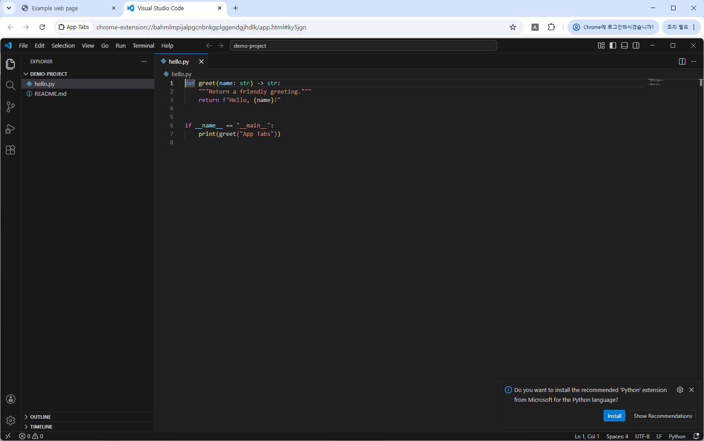
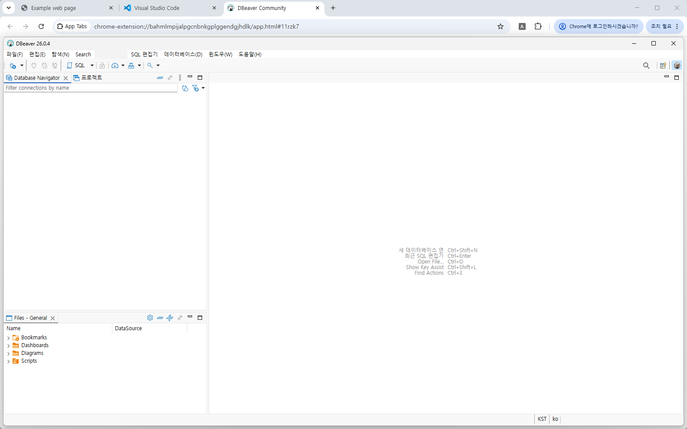
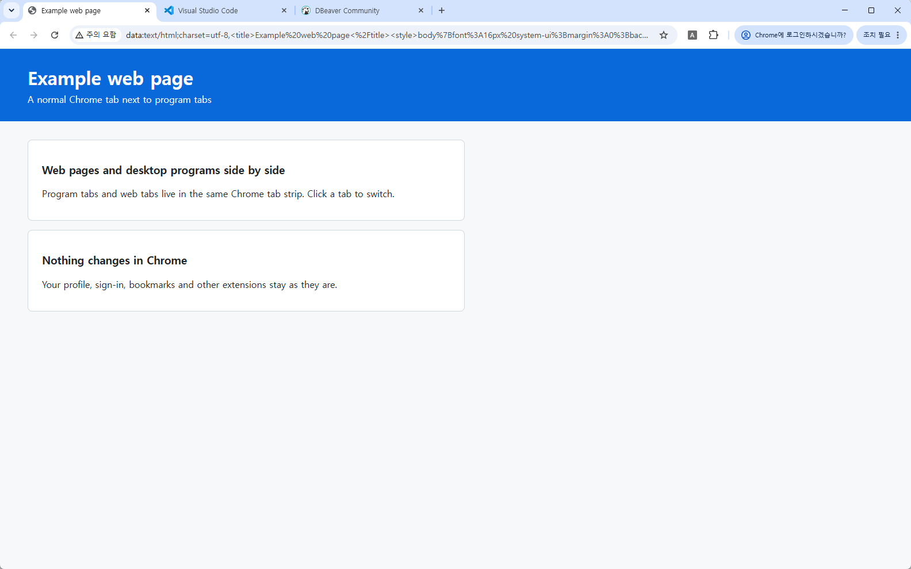
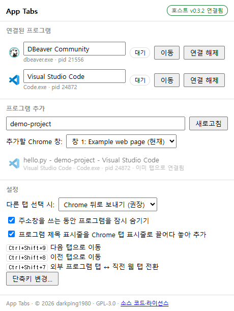

# Chrome App Tabs

**English** | [한국어](README.ko.md)

Use the Windows programs you already have open (VS Code, DBeaver, File Explorer, …) as **tabs in your normal Google Chrome**.
Click a program tab and the program appears in the Chrome page area. Click a web tab and you are back on the web page.

[](https://github.com/darkping1980/chrome-app-tabs/releases/latest)
[](LICENSE)

> **Download:** [Latest release](https://github.com/darkping1980/chrome-app-tabs/releases/latest) → `ChromeAppTabs-vX.Y.Z.zip`
> Free and open source (GPL-3.0). Windows only. Google Chrome only.



---

## Contents

- [What it does](#what-it-does)
- [Screenshots](#screenshots)
- [System requirements](#system-requirements)
- [Install (for users)](#install-for-users)
- [How to use](#how-to-use)
- [Update](#update)
- [Uninstall](#uninstall)
- [Troubleshooting and FAQ](#troubleshooting-and-faq)
- [Known limitations](#known-limitations)
- [For developers](#for-developers)
- [License](#license)

## What it does

Chrome App Tabs is a free, open-source productivity tool for Windows. It adds your running desktop programs to the tab strip of
the Chrome you already use, so you can switch between web pages and desktop programs the same way you switch between tabs.

- **Your own Chrome, unchanged.** Same profile, sign-in, bookmarks, cookies and extensions. No separate browser.
- **Any normal Windows program** can become a Chrome tab: VS Code, DBeaver, File Explorer, Notepad, and so on.
- **Drag and drop:** drag a program's title bar onto the top of a Chrome window (tab strip or address bar) to add it.
- **Management popup:** add, rename, move to, reopen or disconnect program tabs from the toolbar popup.
- **Fast switching** between web pages and desktop programs, with optional global shortcuts.
- **No changes to the programs.** Their files, settings and memory are never touched.
- **Clean disconnect.** When you disconnect a tab (or Chrome closes or crashes), the program window goes back to its original position and size.
- **No administrator rights** are needed to install.
- **Free to use**, licensed under the GNU GPL v3.

### How it works (and what it does not do)

The program window is **not** embedded inside Chrome. Chrome App Tabs uses a **window overlay**: a small native helper
(`AppTabsHost.exe`) moves the real program window exactly over Chrome's page area while its tab is active and puts it
behind Chrome when you choose another tab. It follows Chrome when you move, resize, maximize or minimize it.

It only changes a window's **position, size, visibility, stacking order and focus**. It does **not** inject DLLs, read
other programs' memory, re-parent windows (`SetParent`), modify program files or settings, or close programs. Closing a
program tab never closes the program.

The Chrome extension and the native helper talk through Chrome's official
[Native Messaging](https://developer.chrome.com/docs/extensions/develop/concepts/native-messaging) API.

## Screenshots

| | |
|---|---|
| **VS Code as a Chrome tab**  | **DBeaver as a Chrome tab**  |
| **Back on a normal web tab** (program tabs stay in the tab strip)  | **Management popup** (connected programs, add, settings)  |

The user interface (popup, installer messages) is currently in **Korean**. The screenshots above show the Korean UI;
the labels are explained in [How to use](#how-to-use).

## System requirements

| Item | Requirement |
|---|---|
| Operating system | **Windows 11 64-bit**: tested. Windows 10 64-bit: expected to work, **not tested**. macOS and Linux are not supported. |
| Browser | **Google Chrome** (tested with Chrome 158). Other Chromium browsers (Edge, Brave, …) are **not supported**: the helper is registered for Google Chrome only. |
| Native helper | `AppTabsHost.exe` is **required**. It is included in the release ZIP and installed by `Install-or-Update.cmd`. |
| .NET | .NET Framework 4.x, which is already part of Windows 10/11. Nothing extra to install. |
| Administrator rights | **Not required.** Everything is installed for the current Windows user only. |
| Chrome developer mode | **Required.** Chrome App Tabs is not on the Chrome Web Store, so the extension is loaded as an "unpacked" extension. |
| Developer tools | **Not required** for users. (Developers only need what ships with Windows; see [For developers](#for-developers).) |

## Install (for users)

You do not need to clone or build anything. Everything comes from the GitHub release ZIP.

### Step 1 – Download

1. Open the [**Releases page**](https://github.com/darkping1980/chrome-app-tabs/releases/latest).
2. Under **Assets**, download **`ChromeAppTabs-vX.Y.Z.zip`** (the latest stable version).
3. (Optional) Check that the download is not damaged. Compare the result with the `.sha256` file on the same page:
   ```powershell
   Get-FileHash .\ChromeAppTabs-v0.3.3.zip -Algorithm SHA256
   ```

### Step 2 – Extract and run the installer

4. Right-click the ZIP → **Extract All…** Any location is fine (for example, your Downloads folder).
5. In the extracted folder, double-click **`Install-or-Update.cmd`**.
   - A console window opens and shows what it does (messages are in Korean). No administrator prompt appears.
   - It checks the package files, copies them to `%LOCALAPPDATA%\ChromeAppTabs\app`, and registers one registry key for the current user.
   - Want to see what it would change first? Run `powershell -ExecutionPolicy Bypass -File .\setup.ps1 -DryRun` in that folder.
6. Wait for the completion message (**설치 완료** = "installation complete"), then press any key to close the window.

> **Windows security warning?** The files are not code-signed, so Windows SmartScreen or your antivirus may warn you.
> Download only from this repository's Releases page, check the SHA-256 value, and read the scripts if you like (they are plain text).
> If you are not comfortable, do not run it. **Do not disable Windows security features** to install this program.

### Step 3 – Load the extension in Chrome (one time only)

7. Type **`chrome://extensions`** in the Chrome address bar and press Enter.
8. Turn on **Developer mode** (toggle at the top right).
9. Click **Load unpacked**.
10. A **folder picker** opens. Paste this path into the folder picker's **address bar** and press Enter:
    ```
    %LOCALAPPDATA%\ChromeAppTabs\app\extension
    ```
11. With the **`extension`** folder open (or selected), click **Select Folder**.
12. The **App Tabs** card appears and is enabled. Its ID is `bahmlmpijalpgcnbnkgplggendgjhdlk`.
13. Click the **puzzle icon** (Extensions) in the Chrome toolbar and **pin** App Tabs.
14. Click the **App Tabs** icon. The badge at the top right should say **호스트 v0.3.3 연결됨** ("host v0.3.3 connected").
15. In the popup's **설정** (Settings) section, check that **프로그램 제목 표시줄을 Chrome 탭 표시줄로 끌어다 놓아 추가** (drag-and-drop) is ticked. It is on by default.

> **Common mistakes**
> - The path `%LOCALAPPDATA%\ChromeAppTabs\app\extension` is **not** typed into the Chrome address bar. Type it into the **folder picker** that opens after you click **Load unpacked**.
> - Do **not** open or "run" `manifest.json`. Select the whole **`extension` folder**.
> - Developer mode is needed because Chrome App Tabs is **not on the Chrome Web Store**. You can leave developer mode on.

## How to use

### Add a program by drag and drop

1. Start the program (for example, VS Code).
2. Grab the program window by its **title bar** and drag it onto the **top of a Chrome window**: the tab strip, the address bar
   row or the bookmarks bar. This also works when Chrome is maximized.
3. A **blue drop zone** appears ("여기에 놓으면 Chrome 탭으로 추가" = "drop here to add as a Chrome tab"). Release the mouse.
4. A new tab with the program's name and icon appears in that Chrome window, and the program is shown in the page area.

- Released anywhere else (for example over the web page), the window just moves as usual.
- If you touch the very top edge of the screen, Windows Snap takes over there (maximize / Snap layouts). Move the
  mouse down a little and back up onto Chrome to drop again.
- Press **Esc** while dragging to cancel; the window goes back.
- A program that is already a tab is not added twice.

### Add a program from the popup

1. Click the **App Tabs** toolbar icon.
2. In **프로그램 추가** (Add program), click the window you want. Type part of the window title or program name in the search box to filter the list.
3. If you have several Chrome windows, choose the target in **추가할 Chrome 창** (Chrome window to add to).

### Switch between program tabs and web tabs

- Click a **web tab**: the web page is shown and the program moves behind Chrome.
- Click the **program tab**: the program is shown again. Keyboard and mouse input go straight to the program.
- Clicking the **address bar** on a program tab temporarily moves the program back so you can see the suggestions.
  Press **Esc** (or click the page) to bring it back. If you enter a URL, that tab becomes a web tab and the program returns to its original place.

### Rename, go to, reopen, disconnect

In the popup under **연결된 프로그램** (Connected programs):

| Button / field | What it does |
|---|---|
| Name field | Edit the tab name and press **Enter**. |
| **이동** (Go) | Switch to that tab. |
| **탭 다시 열기** (Reopen tab) | Reopen the tab if it was closed but the connection is still saved (for example, after an update). |
| **연결 해제** (Disconnect) | Close the tab and put the program back where it was. The program keeps running. |

### Keyboard shortcuts

These work even while the program has keyboard focus:

| Shortcut | Action |
|---|---|
| `Ctrl+Shift+7` | Program tab ↔ last web tab |
| `Ctrl+Shift+8` | Previous tab |
| `Ctrl+Shift+9` | Next tab |

Change them with **단축키 변경…** (Change shortcuts) in the popup, which opens `chrome://extensions/shortcuts`.
Keep the scope set to **Global** so they also work while a program has focus.

### Settings (bottom of the popup)

| Setting | Options |
|---|---|
| **다른 탭 선택 시** (When another tab is selected) | **Chrome 뒤로 보내기** (send behind Chrome, recommended) or **최소화** (minimize) |
| **주소창을 쓰는 동안 프로그램을 잠시 숨기기** | Temporarily hide the program while you use the address bar (on/off) |
| **프로그램 제목 표시줄을 Chrome 탭 표시줄로 끌어다 놓아 추가** | Drag and drop to add (on/off). When off, moving windows behaves exactly as normal. |

## Update

1. Download the latest `ChromeAppTabs-vX.Y.Z.zip` from [Releases](https://github.com/darkping1980/chrome-app-tabs/releases/latest).
2. Extract it.
3. Run **`Install-or-Update.cmd`**.
   - If App Tabs is running, it asks for confirmation (`Y`). It stops **only the App Tabs helper**. Chrome, VS Code and other programs are **not** closed;
     connected program windows return to their original position, and unsaved work in them is kept.
4. Wait for the completion message (**업데이트 완료** = "update complete").
5. Open **`chrome://extensions`**.
6. Click the **reload button (↻)** on the **App Tabs** card. **This step is required.** Without it, Chrome keeps running the old extension code.
7. Open the App Tabs popup and check that the badge shows the new host version.
   Program tabs closed by the reload can be reopened with **탭 다시 열기** (Reopen tab).

What is kept across updates: the install folder, the **extension ID** (fixed by the public key in `manifest.json`), your
connected programs and your settings. You do **not** need to remove or re-add the extension.

**If an update fails:** the installer prepares the new version in a separate folder and swaps it in. If anything fails during
the swap, it **automatically restores the previous version** ("이전 상태로 복구했습니다"). A damaged ZIP is rejected before anything changes.
The last 3 previous versions are kept in `%LOCALAPPDATA%\ChromeAppTabs\backup`. To go back to an older version on purpose,
run `setup.ps1 -AllowDowngrade` from that older version's package (downgrades are blocked otherwise).

## Uninstall

1. **Disconnect** your program tabs in the popup (optional: uninstalling also puts windows back).
2. In **`chrome://extensions`**, click **Remove** on the App Tabs card.
3. In the extracted release folder, run **`Uninstall.cmd`**
   (or `powershell -ExecutionPolicy Bypass -File .\uninstall.ps1 -Purge` to also delete logs and saved state).
   - If the helper is still running, it asks you to turn off the extension first (or run `uninstall.ps1 -StopHost`).

What the uninstaller removes:

| Item | Location |
|---|---|
| Program files | `%LOCALAPPDATA%\ChromeAppTabs\app` (and leftovers of interrupted updates) |
| Registry key (current user only) | `HKCU\Software\Google\Chrome\NativeMessagingHosts\com.kbj.chrome_app_tabs` |
| With `-Purge` | the whole `%LOCALAPPDATA%\ChromeAppTabs` folder (log `host.log`, state `attached.json`, backups) |

It does not close Chrome or any other program and does not touch your Chrome profile.

## Troubleshooting and FAQ

**The popup says the host is not connected (호스트 연결 실패).**
Run `check.ps1` in the extracted release folder (right-click → *Run with PowerShell*). It checks the registry key, the helper
file, the allowed extension ID and the helper version. If something is missing, run `Install-or-Update.cmd` again, then reload the extension (↻).
Also check that the extension ID is `bahmlmpijalpgcnbnkgplggendgjhdlk`: it must be loaded from `%LOCALAPPDATA%\ChromeAppTabs\app\extension`.

**Drag and drop does nothing.**
Check that the drag-and-drop setting is on in the popup and the host is connected. Drag by the program's **title bar**
(not by a tab or toolbar inside the program) and release over the **tab strip or address bar** of a Chrome window, where the
blue zone is shown. If it still does not work,
add the program from the popup instead.

**Dragging onto a maximized Chrome window maximizes or snaps my program instead.**
The very top edge of the screen belongs to Windows Snap. Since v0.3.3 the whole address bar row is a drop zone as well,
so release a little lower (on the tabs or the address bar). After touching the top edge, move the mouse down once
(about 120 px) before dropping, because the Snap layouts bar may still be open there.

**After an update I still see the old version / the popup says "새 버전이 설치되었습니다".**
Open `chrome://extensions` and click **↻** on the App Tabs card. Reopen closed program tabs with **탭 다시 열기**.

**A program tab does not switch correctly, or a window stays in the wrong place.**
Click **연결 해제** (Disconnect) in the popup, or turn the App Tabs extension off and on in `chrome://extensions`;
the window returns to its original position. Then add the program again. The helper log is `%LOCALAPPDATA%\ChromeAppTabs\host.log`.

**Chrome crashed. Where is my program?**
A watchdog process restores connected windows to their original position when Chrome or the helper exits unexpectedly.
The program itself keeps running.

**Windows shows a security warning.**
The release is not code-signed. See the note in [Install](#step-2--extract-and-run-the-installer). Never turn off Windows security to run it.

**Multiple monitors.**
Moving Chrome to another monitor and dragging onto a Chrome window on another monitor were tested on monitors with the
**same** scaling (100%). Monitors with **different** display scaling (DPI) are handled in the code (physical pixels,
per-monitor scale) and unit tested, but have **not** been tested on real hardware yet. Please report problems in Issues.

**How do I remove a program from Chrome without closing it?**
Use **연결 해제** (Disconnect) in the popup, or simply close the program tab. The program keeps running.

**Does it work with Edge or other browsers?**
No. Only Google Chrome is supported.

## Known limitations

- **Not embedded:** the program is overlaid on Chrome, not inside it. The program's own title bar is visible, and its own close button (X) really closes the program.
- **Top screen edge + drag and drop:** the top edge belongs to Windows Snap; drop a little lower (see FAQ).
- **Manual reload after update:** you must click ↻ on the App Tabs card after each update; the reload closes program tabs (reopen them from the popup).
- **UWP apps** (e.g. Calculator) get the tab name "Application Frame Host". Rename the tab in the popup.
- **Not tested:** monitors with different DPI scaling, programs running as administrator (Windows UIPI is expected to prevent control), Windows 10.
- **Korean-only UI** for the popup and installer messages.
- **Not code-signed** and **not on the Chrome Web Store** (developer mode is required).

## For developers

### Get the source

```powershell
git clone https://github.com/darkping1980/chrome-app-tabs.git
cd chrome-app-tabs
```

### Project layout

```
extension/   Chrome extension (Manifest V3): background.js (service worker), popup.*, app.* (program tab page)
host/        Native helper AppTabsHost.exe (C#, .NET Framework 4.x)
             AppTabsHost.cs (window management, watchdog), DragAdd.cs (drag to add), AssemblyInfo.cs, build.ps1
install/     setup.ps1 (install/update/rollback), uninstall.ps1, check.ps1, install.ps1 (old entry point)
tools/       build-release.ps1: builds dist\ChromeAppTabs-vX.Y.Z.zip + .sha256
tests/       End-to-end and compatibility tests (Node.js + Win32 helper probe.cs), dev-host.ps1
docs/        MANUAL.md / MANUAL.ko.md (included in the release ZIP), images/
```

### Architecture

```
 Chrome (your profile)                                       Windows
 ┌──────────────────────────────────────────┐   Native      ┌───────────────────────────────┐
 │ App Tabs extension (MV3)                 │   Messaging   │ AppTabsHost.exe (per user)     │
 │  • background.js: tabs ↔ program windows │◀────────────▶│  • lists top-level windows      │
 │  • app.html#<id>: the "program tab" page │  JSON over    │  • places the program window    │
 │  • popup.html: manage / add / settings   │  stdin/stdout │    over Chrome's page area      │
 └──────────────────────────────────────────┘               │  • WinEvent hooks follow Chrome │
                                                            │  • drag-to-add (DragAdd.cs)     │
                                                            │  • watchdog restores windows    │
                                                            └───────────────────────────────┘
```

- The extension knows only tabs. When a program tab becomes active it asks the helper to `activate` that program;
  the helper positions the real window over Chrome's content area and keeps it in sync (move, resize, minimize, monitor change).
- Chrome finds the helper through `HKCU\Software\Google\Chrome\NativeMessagingHosts\com.kbj.chrome_app_tabs`, which points
  to a JSON manifest that allows only the extension ID `bahmlmpijalpgcnbnkgplggendgjhdlk`.
- The extension ID is fixed by the **public** key in `extension/manifest.json`. That key is public by design;
  no private signing key is needed or stored in this repository.
- Drag to add uses out-of-process `SetWinEventHook` (move/size start/end), one `WM_NCHITTEST` and plain window geometry
  (Chrome's UI above its web-content child window) to find the drop zone; nothing is injected into other processes.
  Details: [docs/drag-drop-analysis.md](docs/drag-drop-analysis.md).

### Build the native helper

No SDK is needed. The C# compiler that ships with .NET Framework 4.x is used:

```powershell
powershell -File host\build.ps1          # -> host\bin\AppTabsHost.exe
```

### Development setup

Tests and development use a **separate** native host name so they never touch an installed copy:

```powershell
powershell -File tests\dev-host.ps1      # registers com.kbj.chrome_app_tabs_dev -> host\bin\AppTabsHost.exe
powershell -File tests\dev-host.ps1 -Remove
```

The dev build stores its log and state in `%LOCALAPPDATA%\ChromeAppTabs-dev`. You can also install from source with
`powershell -ExecutionPolicy Bypass -File install\setup.ps1` (it builds the helper first).

### Run tests

The end-to-end tests start an **isolated** Chrome (temporary profile, extension loaded over the DevTools pipe) and an isolated
VS Code (its own `--user-data-dir`), and inject **real mouse and keyboard input**. Do not use the PC while they run.

```powershell
# one-time: build the Win32 test helper
& "$env:WINDIR\Microsoft.NET\Framework64\v4.0.30319\csc.exe" /nologo /out:tests\bin\probe.exe /r:System.Drawing.dll tests\probe.cs
powershell -File tests\dev-host.ps1
powershell -File tests\unit\run.ps1     # unit tests of the drag-to-add decisions (no UI)
node tests\e2e.mjs <workDir>             # switching, focus, omnibox, restore, drag to add
node tests\drag_test.mjs <workDir> [10]  # drag to add: maximized/normal Chrome, several programs, Snap, Esc, success rate
node tests\compat_test.mjs <workDir>     # VS Code, Notepad, Explorer, Calculator, Character Map
node tests\update_test.mjs <workDir> dist\ChromeAppTabs-vX.Y.Z.zip   # install/update/rollback in an isolated folder
powershell -File tests\dev-host.ps1 -Remove
```

Requirements: Node.js 18+ (only built-in modules are used; there is no `package.json`), Google Chrome, VS Code for the VS Code scenarios.
`<workDir>` must be a scratch folder; test output can contain local paths, so do not commit it.

### Build a release package

```powershell
powershell -File tools\build-release.ps1  # -> dist\ChromeAppTabs-v<version>.zip and .zip.sha256
```

The version comes from `extension/manifest.json` and must match `Version` in `host/AppTabsHost.cs` and `host/AssemblyInfo.cs`.
The package contains the helper, the extension, the install/update/uninstall/check scripts, `LICENSE.txt`, `SOURCE.txt`
(link to the matching source tag) and the manuals. Releases are published from a tag `vX.Y.Z` that matches the package.

### Contributing

Bug reports and feature ideas are welcome in [GitHub Issues](https://github.com/darkping1980/chrome-app-tabs/issues).
See [CONTRIBUTING.md](CONTRIBUTING.md) for pull requests and attribution, [SECURITY.md](SECURITY.md) for security issues,
and [CHANGELOG.md](CHANGELOG.md) for the version history.

## License

Copyright (C) 2026 darkping1980

Chrome App Tabs is free software: you can redistribute it and/or modify it under the terms of the
**GNU General Public License version 3** (GPL-3.0-only), as published by the Free Software Foundation. See [LICENSE](LICENSE).

In short: you may use it for free (personally or at work), read and change the source code, and share or even sell copies.
If you distribute it or a modified version, you must keep the copyright notices, license it under GPL v3 and make the
corresponding source code available. The program comes with **no warranty** and no obligation of technical support.
Only the license text itself is legally binding.
